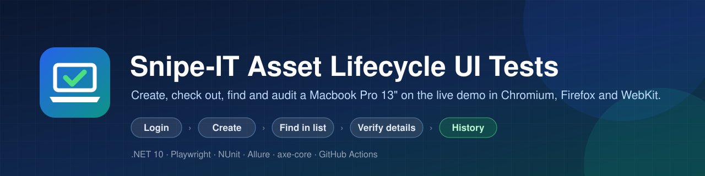
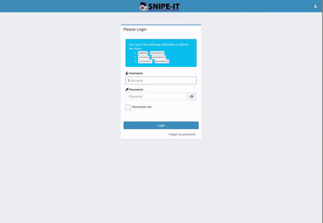
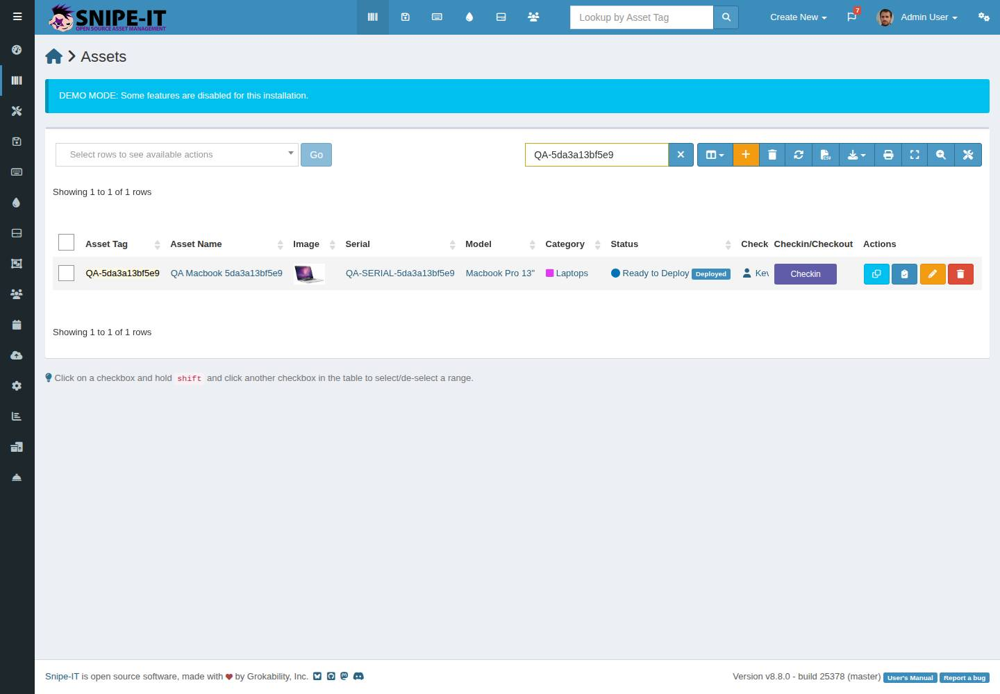
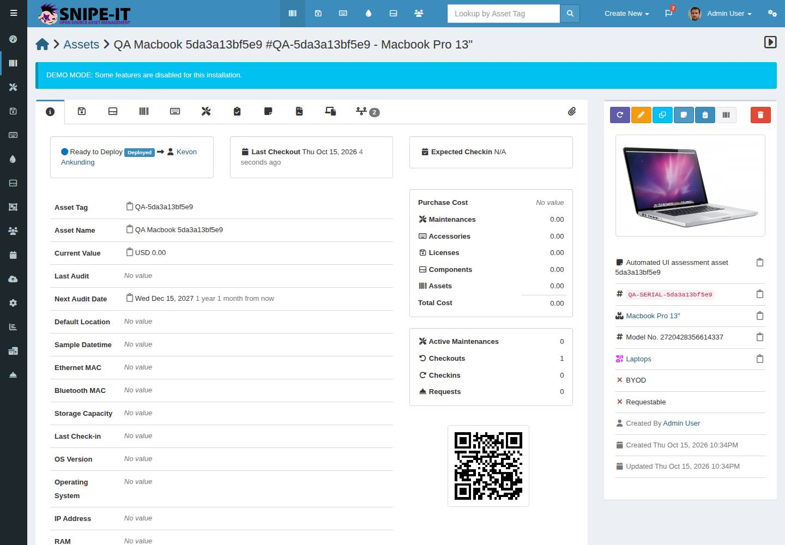
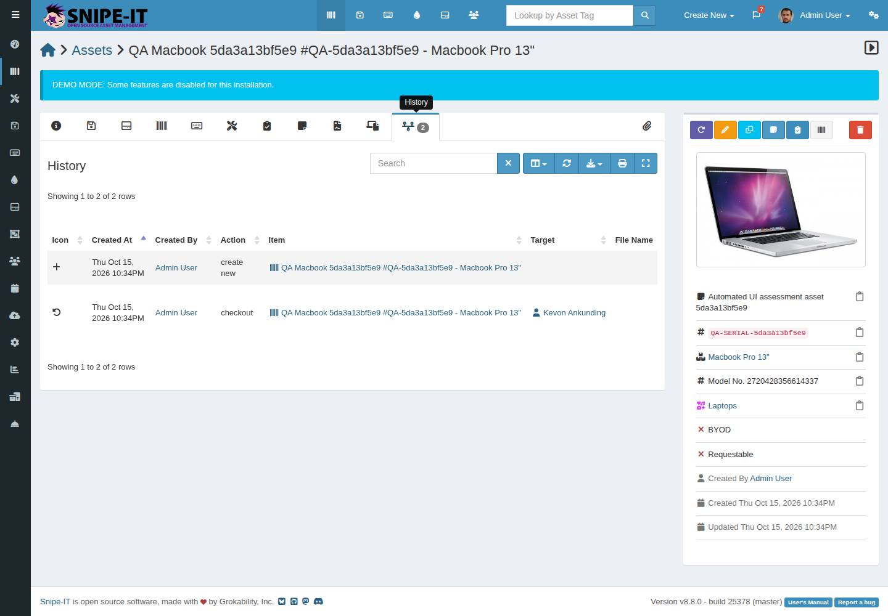
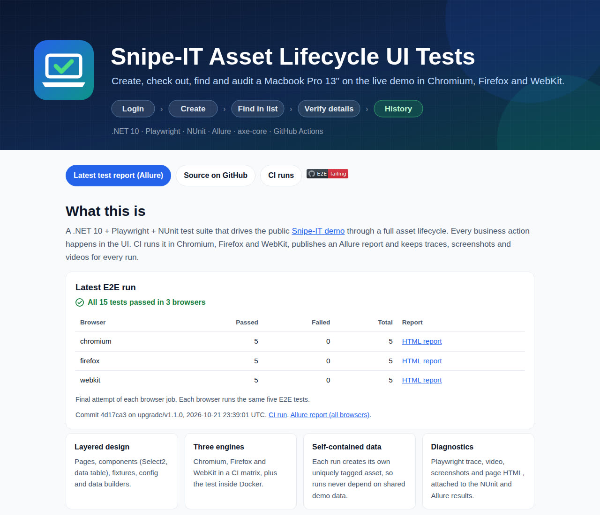
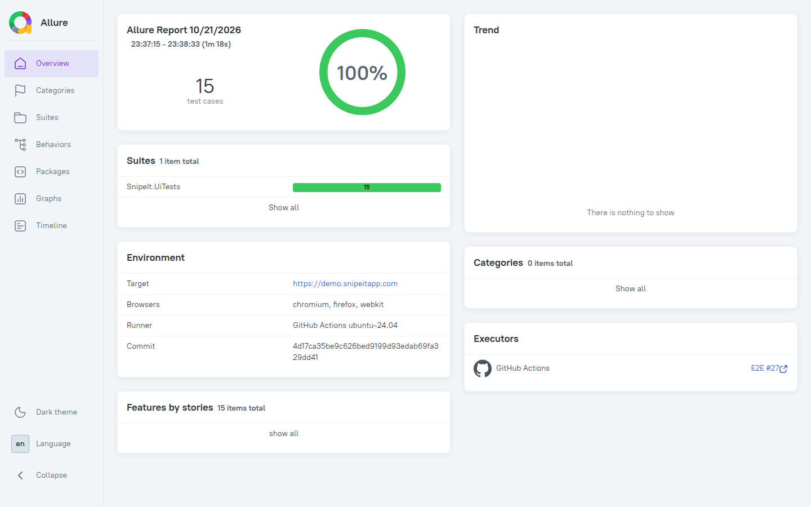
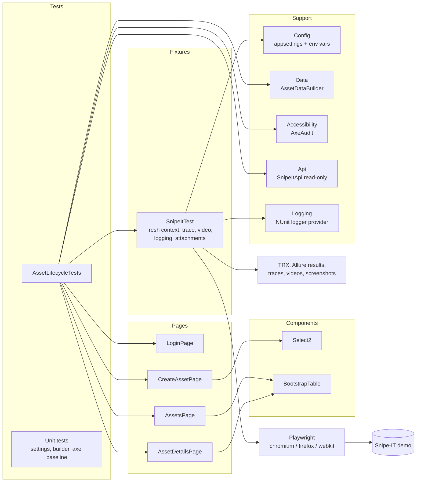
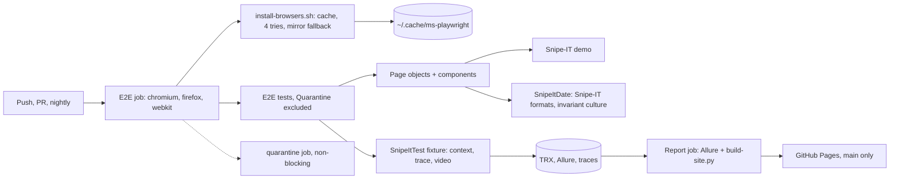

<p align="center">
  
</p>

<p align="center">
  <a href="https://github.com/muhib-karim/global360-qa-automation/actions/workflows/build.yml"></a>
  <a href="https://github.com/muhib-karim/global360-qa-automation/actions/workflows/e2e.yml"></a>
  <a href="https://github.com/muhib-karim/global360-qa-automation/actions/workflows/codeql.yml"></a>
  <a href="https://github.com/muhib-karim/global360-qa-automation/releases"></a>
  <br>
  
  
  
  
  
</p>

An end-to-end UI test for the public [Snipe-IT demo](https://demo.snipeitapp.com/login), written in C# with
.NET 10, Playwright and NUnit. It signs in, creates a `Macbook Pro 13"` asset that is **Ready to Deploy** and
checked out to a random user, finds it in the assets list, opens it, and validates its details and its
**History** tab. GitHub Actions runs it in Chromium, Firefox and WebKit and in Docker, and publishes an Allure
report plus traces, videos and screenshots for every run.

<p align="center">
  
</p>

| | |
| --- | --- |
| **UI-first, as briefed** | Every business action (login, create, check out, search, open, History) happens in the browser. |
| **Layered design** | Pages, components (Select2, data table), a base fixture, config and data builders. |
| **Three engines** | Chromium, Firefox and WebKit in a CI matrix, plus the same test inside a Docker image. |
| **Self-contained data** | Each run creates its own asset with a GUID-based tag; nothing depends on shared demo records. |
| **Explicit assertions** | Playwright web-first assertions only; no sleeps, no forced clicks, no in-test retries. |
| **Diagnostics** | Trace, video, page screenshots, failure HTML and `run.json`, attached to NUnit (TRX) and Allure. |
| **Accessibility smoke** | axe-core scans of the four visited pages, gated on new critical rules against a recorded baseline. |
| **API cross-check** | A read-only `GET /api/v1/hardware` lookup, using the signed-in session, confirms what the UI shows. |
| **Quality gates** | Locked restore, analyzers with warnings as errors, `dotnet format`, unit tests, gitleaks, CodeQL. |

### Screenshots from a passing CI run

| Assets list, filtered by the new tag | Asset page details | History tab |
| --- | --- | --- |
|  |  |  |

The GIF and screenshots are produced by the `e2e (chromium)` job (artifact `readme-media`) of run
[38841064770](https://github.com/muhib-karim/global360-qa-automation/actions/runs/38841064770) and show only the
public demo.

### Latest E2E report

Every run builds the GitHub Pages site with the latest pass counts per browser, each browser's HTML report and
the merged Allure report. These screenshots come from the `site-screenshots` artifact of E2E run
[39694502145](https://github.com/muhib-karim/global360-qa-automation/actions/runs/39694502145) on
`upgrade/v1.1.0` (15 of 15 passed in Chromium, Firefox and WebKit).

| Pages homepage: latest run | Allure overview |
| --- | --- |
|  |  |

## Contents

- [Overview](#overview)
- [Brief](#brief)
- [Quick start](#quick-start)
- [Design decisions](#design-decisions)
- [Architecture](#architecture)
- [Project structure](#project-structure)
- [Configuration](#configuration)
- [Running](#running)
- [The test flow step by step](#the-test-flow-step-by-step)
- [How the History tab is validated](#how-the-history-tab-is-validated)
- [Flakiness and test data strategy](#flakiness-and-test-data-strategy)
- [Test matrix](#test-matrix)
- [Reports and diagnostics](#reports-and-diagnostics)
- [Accessibility gate](#accessibility-gate)
- [API cross-check](#api-cross-check)
- [Quality gates](#quality-gates)
- [Troubleshooting](#troubleshooting)
- [Known limitations](#known-limitations)
- [Next steps](#next-steps)
- [Licence](#licence)

## Overview

The lifecycle test, `AssetLifecycleTests.Macbook_can_be_created_checked_out_found_and_audited`, walks through
the whole lifecycle in a fresh browser context. Four more E2E tests cover the rest: a checked-out asset is checked
in (`AssetManagementTests.Checked_out_asset_can_be_checked_in`), an asset is edited and deleted
(`Asset_can_be_edited_and_deleted`), the create form refuses an asset without its required fields
(`Asset_without_required_fields_is_refused`), and a wrong password is rejected
(`LoginTests.Wrong_password_is_rejected`). Page objects hold the interactions and UI assertions, so each test
reads like the brief. A base fixture owns the browser context, tracing, video, logging and the artifacts.



## Brief

The employer's brief, verbatim:

* Use the latest version of .NET and Playwright 
* Follow best practices around code, testing and architecture as you understand them 
* The automation script should follow these steps: 

* Login to the snipeit demo at https://demo.snipeitapp.com/login 
* Create a new Macbook Pro 13" asset with the ready to deploy status and checked out to a random user 
* Find the asset you just created in the assets list to verify it was created successfully 
* Navigate to the asset page from the list and validate relevant details from the asset creation 
* Validate the details in the "History" tab on the asset page 

* Email us your solution in the form of a link to a git repository 
* If any special instructions are needed to run the project, put them in a readme in the repository

## Quick start

You need the .NET 10 SDK (10.0.402 or a later 10.0.4xx patch, see `global.json`), PowerShell 7 (`pwsh`) for
Playwright's browser installer, and internet access to NuGet and the demo.

```sh
dotnet restore --locked-mode
dotnet build --no-restore
pwsh tests/SnipeIt.UiTests/bin/Debug/net10.0/playwright.ps1 install --with-deps chromium
dotnet test --no-build --filter TestCategory=E2E --logger "console;verbosity=normal"
```

`--with-deps` installs the browser's OS packages and may need administrator rights; leave it out if they are
already present. No credentials need to be configured: the defaults are the demo's published admin account.

## Design decisions

- **UI for every business action.** The brief is a UI automation task, so login, creation, checkout, search,
  navigation and History are all driven through the browser. The REST API is used once, read-only, as a
  secondary cross-check after the UI checks passed.
- **Page Object Model with components.** Pages expose intent (`CreateAndCheckOutAsync`, `VerifyHistoryAsync`).
  Reusable widgets live in `Components`: `Select2` for the demo's custom dropdowns and `BootstrapTable`, which
  finds columns by their `data-field` header instead of by position, so a reordered or added column does not
  silently shift assertions.
- **Locators.** Accessible roles and labels first (`GetByRole`, `GetByLabel`). Stable IDs where the demo's labels
  are not associated with their inputs, or where tab labels are icons with counts.
- **Web-first assertions only.** Every UI check is an `Expect(...)` assertion that waits for the condition.
  There are no fixed sleeps (`Thread.Sleep`, `Task.Delay`), `WaitForTimeout` calls or forced clicks; CI fails the build if one appears.
- **Fresh context per test, unique data per run.** No state is shared between tests, so the design is
  parallel-safe. In CI the three browser jobs create their own assets on the demo at the same time.
- **Configuration.** `appsettings.json` with environment variable overrides (Microsoft.Extensions.Configuration).
  The original `SNIPE_*` variables still work and take precedence. A guard refuses any target other than
  `https://demo.snipeitapp.com`, because the suite writes data.
- **Structured logging.** Microsoft.Extensions.Logging with source-generated `[LoggerMessage]` methods and a small
  provider that writes one line per event to the NUnit test output (console, TRX and Allure). Each step, the asset
  tag, the user seed, the selected user, the axe results and the API cross-check are logged.
- **Retries belong to CI, not to tests.** A test that retries itself hides real failures. CI re-runs a failed
  job's test step once and reports it (see [Flakiness](#flakiness-and-test-data-strategy)).
- **Pinned toolchain.** .NET SDK via `global.json`, NuGet packages via lock files and `--locked-mode`, GitHub
  Actions by commit SHA, Allure CLI and gitleaks by version and SHA-256. Runners are pinned to `ubuntu-24.04`
  because GitHub announced that `ubuntu-latest` moves to Ubuntu 26 from 19 October 2026; the move should be a
  reviewed change, not a surprise.
- **Latest .NET and Playwright.** .NET 10 (SDK 10.0.402) and Microsoft.Playwright.NUnit 1.63.0 were the newest
  stable releases on nuget.org and dotnet.microsoft.com when this was built. NUnit stays on 4.6.1 (newest 4.x):
  NUnit 5.0.0 shipped on 27 September 2026 and Allure.NUnit 2.15.0 and Playwright.NUnit 1.63.0 are built against
  NUnit 3.x, so the major upgrade is left to its own reviewed pull request.

## Architecture

The [interactive diagram](https://muhib-karim.github.io/global360-qa-automation/architecture.html)
([source](docs/architecture.html), built with Archify from the code at the pinned commit, each box linked to its
source lines) shows the test layers and the CI pipeline together:



A structural graph of the test project (graphify, AST only: 212 nodes, 558 edges) has the expected hubs: the
`SnipeItTest` base fixture, then `AssetDetailsPage`, `AssetData`, `Select2` and `CreateAssetPage`. Tests talk to
page objects and page objects to components, which is what keeps a demo change local to one page object.

## Project structure

```text
.
├── .devcontainer/devcontainer.json      Codespaces / dev container
├── .github/
│   ├── workflows/build.yml              build-and-format, unit tests, guardrails, gitleaks, docker
│   ├── workflows/e2e.yml                browser matrix, Allure report, GitHub Pages
│   ├── workflows/codeql.yml             CodeQL for C#
│   ├── scripts/                         demo preflight, CI-level retry, job summary,
│   │                                    browser install with retries, Pages site builder
│   ├── ISSUE_TEMPLATE/, PULL_REQUEST_TEMPLATE.md, CODEOWNERS, dependabot.yml
├── docs/
│   ├── index.html                       GitHub Pages homepage with the latest run's pass counts
│   ├── architecture.html                interactive architecture diagram (Archify)
│   ├── assets/ (banner.svg, logo.svg), img/ (screenshots, demo.gif)
│   └── verification.md                  what CI verified, with run links
├── tests/SnipeIt.UiTests/
│   ├── Accessibility/AxeAudit.cs        axe scans, baseline comparison
│   ├── Api/SnipeItApi.cs                read-only REST cross-check
│   ├── Components/                      Select2.cs, BootstrapTable.cs
│   ├── Config/TestSettings.cs           settings, overrides, host guard
│   ├── Data/AssetData.cs                asset record, AssetDataBuilder
│   ├── Data/SnipeItDate.cs              reads Snipe-IT display dates in every format it offers
│   ├── Fixtures/SnipeItTest.cs          context, tracing, video, artifacts
│   ├── Fixtures/QuarantineAttribute.cs  time-boxed quarantine for a flaky test
│   ├── Logging/                         NUnit logger provider, log messages
│   ├── Pages/                           Login, CreateAsset, Assets, AssetDetails
│   ├── Tests/AssetLifecycleTests.cs     the lifecycle end-to-end test (category E2E)
│   ├── Tests/AssetManagementTests.cs    check-in, edit and delete, required fields (category E2E)
│   ├── Tests/LoginTests.cs              wrong password rejected (category E2E)
│   ├── Tests/Unit/                      unit tests (category Unit)
│   ├── appsettings.json                 defaults
│   └── accessibility-baseline.json      known critical axe rules per page
├── Dockerfile, .dockerignore
├── Directory.Build.props, .editorconfig, global.json, SnipeIt.sln
└── README.md, CONTRIBUTING.md, CHANGELOG.md, SECURITY.md, HANDOFF.md, SKILLS_USED.md
```

## Configuration

Settings come from `tests/SnipeIt.UiTests/appsettings.json`, then environment variables in the standard
`Section__Key` form, then the original `SNIPE_*` variables (highest precedence). All are optional.

| Setting | Environment variable | Default | Purpose |
| --- | --- | --- | --- |
| `Snipe:BaseUrl` | `SNIPE_BASE_URL` or `Snipe__BaseUrl` | `https://demo.snipeitapp.com` | Only HTTPS on this demo host is accepted. |
| `Snipe:Username` | `SNIPE_USERNAME` | `admin` | Public demo credentials, printed on the demo login page. Not secrets. |
| `Snipe:Password` | `SNIPE_PASSWORD` | `password` | As above. |
| `Snipe:UserSeed` | `SNIPE_USER_SEED` | random per run | Seed for picking the user. Logged, so a run can be replayed. |
| `Snipe:TimeoutMs` | `Snipe__TimeoutMs` | `20000` | Playwright action and assertion timeout. |
| `Diagnostics:Trace` | `Diagnostics__Trace` | `RetainOnFailure` | `Off`, `On` or `RetainOnFailure`. CI uses `On`. |
| `Diagnostics:Video` | `Diagnostics__Video` | `RetainOnFailure` | `Off`, `On` or `RetainOnFailure`. CI uses `On`. |
| `Diagnostics:OutputDir` | `Diagnostics__OutputDir` | `<test output>/artifacts` | Where each run's artifact folder is created. |
| `Accessibility:Enforce` | `Accessibility__Enforce` | `true` | Fail on critical axe rules missing from the baseline. |
| (Playwright) | `BROWSER` | `chromium` | `chromium`, `firefox` or `webkit`. |
| (Playwright) | `HEADED` | unset | `1` shows the browser window. |

User selection is uniform among the options in the first page the user dropdown loads, not among every user in
the database. The shared demo's user list changes, so a fixed seed replays the choice only while the list is
the same.

## Running

### Locally

See [Quick start](#quick-start). Useful variations:

```sh
BROWSER=firefox dotnet test --no-build --filter TestCategory=E2E     # install firefox first
HEADED=1 dotnet test --no-build --filter TestCategory=E2E            # watch it
SNIPE_USER_SEED=1350408047 dotnet test --no-build --filter TestCategory=E2E
dotnet test --no-build --filter TestCategory=Unit                    # no browser, no network
```

In PowerShell set variables with `$env:BROWSER = "firefox"` first. To view a trace:
`pwsh tests/SnipeIt.UiTests/bin/Debug/net10.0/playwright.ps1 show-trace <path>/trace.zip`.

### Docker

```sh
docker build -t snipeit-uitests .
docker run --init --ipc=host --name snipeit-e2e snipeit-uitests
docker cp snipeit-e2e:/src/TestResults ./TestResults      # TRX
docker cp snipeit-e2e:/src/artifacts ./artifacts          # run.json, axe results, screenshots
```

The image is based on `mcr.microsoft.com/dotnet/sdk:10.0.402-noble`, restores in locked mode, builds Release,
installs Chromium with its OS packages and runs the E2E test headless as the image's non-root `app` user.
Browsers are installed by the same Playwright package the tests use, so the versions always match.

### Dev container

`.devcontainer/devcontainer.json` uses `mcr.microsoft.com/devcontainers/dotnet:2-10.0-noble` with PowerShell, then
restores, builds and installs Chromium. Open the repository in GitHub Codespaces or with the VS Code Dev
Containers extension and run the Quick start `dotnet test` command. The dev container is not exercised in CI.

### CI

| Workflow | Trigger | Jobs |
| --- | --- | --- |
| `build.yml` (Build and format) | pull request, push to `main` or `upgrade/**`, manual | `build-and-format`, `gitleaks`, `docker` |
| `e2e.yml` (E2E) | pull request, push to `main` or `upgrade/**`, nightly 03:17 UTC, manual | `e2e (chromium)`, `e2e (firefox)`, `e2e (webkit)`, `quarantine (chromium, non-blocking)`, `Allure report`, `Publish GitHub Pages` |
| `codeql.yml` (CodeQL) | pull request, push to `main` or `upgrade/**`, weekly | `CodeQL (csharp)` |

All workflows use read-only `contents` permission by default, concurrency groups, timeouts and actions pinned by
commit SHA. Only the Pages job gets `pages: write` and `id-token: write`, and it runs only for `main` (push,
schedule or manual run), never for pull requests. The nightly run and the
[Pages site](https://muhib-karim.github.io/global360-qa-automation/) run from `main`.

## The test flow step by step

| # | Step | What is asserted |
| --- | --- | --- |
| 1 | Open `/login` | HTTP status is not 5xx (the demo returns 503 while it resets), the Login button is visible. axe scan `login`. |
| 2 | Sign in as the demo admin | The Dashboard heading is visible. The signed-in display name is kept as the expected History actor. |
| 3 | Open `/hardware/create` | The "Assets Create New" heading is visible. axe scan `create-asset`. |
| 4 | Fill and submit the form | Unique tag, serial, name and notes; model `Macbook Pro 13"` (exactly one search match); status `Ready to Deploy`; a random user from the checkout dropdown. A success alert appears. |
| 5 | Search the assets list by tag | Exactly one row contains the tag, and it shows the name, serial, model, status and a link to the selected user. axe scan `assets-list`. |
| 6 | Open the asset from that row | The page heading contains the tag. |
| 7 | Verify details | Tag, name, serial, model and notes fields; the status box shows `Ready to Deploy`, `Deployed` and a link to the selected user. axe scan `asset-page`. |
| 8 | Open History and verify | See [How the History tab is validated](#how-the-history-tab-is-validated). |
| 9 | API cross-check | `GET /api/v1/hardware?search=<tag>` returns 200 and exactly this asset with the same tag, name, serial, model, status and assigned user id. |
| 10 | Accessibility gate | No page has a critical axe rule that is missing from `accessibility-baseline.json`. |

"Ready to Deploy" is the asset's status label; Snipe-IT adds the "Deployed" badge after checkout. Both are
expected together.

## How the History tab is validated

The History table (`#assetHistoryListingTable`) is a bootstrap-table. Columns are located through the
`data-field` attribute of their header, never by index.

- The table has exactly **2 rows**: exactly one whose Action cell is `create new` and exactly one whose Action
  cell is `checkout`.
- For **both** rows:
  - **Item**: a link to this asset's own path (the asset page URL) whose text contains the tag, the name and the
    model `Macbook Pro 13"`.
  - **`created_by`**: exactly the signed-in user's display name (read from the user menu after login).
  - **`created_at`**: parsed by `SnipeItDate` with Snipe-IT's own date and time display formats (the demo's
    format is a shared setting: `Wed Oct 21, 2026 4:31AM` one day, `2026-10-20 04:28` the day before) and the
    invariant culture, so the runner's locale does not matter. The value must be a server-local time of this run
    in some real timezone (UTC-12 to UTC+14; the demo runs at UTC-4), and the two rows must be within two
    minutes of each other. See [HANDOFF.md](HANDOFF.md) for why the earlier regex failed.
  - **`quantity`**: exactly `1`.
- **`create new` row**: `target` is empty.
- **`checkout` row**: `target` contains a link to `/users/<selected user id>` whose text is the selected user's
  display name, and `note` is exactly `Checked out on asset creation`.

## Flakiness and test data strategy

The demo is a shared public Snipe-IT instance. Anyone can change it, and it periodically resets its database.
During a reset it answers HTTP 503 with a "Resetting the database" page.

- **Self-contained data.** Each run creates its own asset with the tag `QA-<12 hex characters from a GUID>` and
  matching name, serial and notes. It never edits or relies on existing assets; the only existing records it
  uses are the `Macbook Pro 13"` model, the `Ready to Deploy` status and a randomly chosen user, which are part of
  the demo's seed data.
- **Unique tags make lookups exact.** The list search, row checks and API cross-check all key on the new tag, so
  other people's assets cannot match.
- **No cleanup of shared data.** The test leaves its asset in place. Deleting records in a shared demo could
  interfere with other users, the demo's reset removes them, and the asset stays inspectable after a failure.
  This is a deliberate choice for this demo, not a production cleanup policy.
- **Parallel-safe by design.** A fresh browser context per test, no static mutable state, unique data. The
  three browser jobs run concurrently against the demo in every CI run.
- **Preflight.** Before each attempt CI polls `/login` for up to 6 minutes until it returns 200, so a reset in
  progress delays the run instead of failing it. The login page object also fails with an explicit "demo
  unavailable" message on a 5xx response.
- **Retry policy.** Tests never retry themselves. If a job's test step fails, `.github/scripts/retry-once.sh`
  runs it once more after another preflight, logs a `CI-level retry` warning, keeps both attempts' TRX files and
  artifacts, and reports the outcome (`passed`, `passed-on-retry` or `failed`) in the job summary. A failure on
  the second attempt fails the job. Rationale: the demo is outside our control, so one rerun absorbs a reset or
  a network blip, while a repeatable failure still surfaces. A `passed-on-retry` result is a signal to
  investigate, not a pass to ignore. The build job self-tests the script's three outcomes on every pull request.
  Whether a live run needed the retry is visible in its summary; [docs/verification.md](docs/verification.md)
  records it for the cited runs.
- **Browser install.** `.github/scripts/install-browsers.sh` installs each engine with up to four attempts and
  exponential backoff (10, 20, 40 s). Attempts 1 and 2 use Playwright's own host list; attempts 3 and 4 pin
  `PLAYWRIGHT_DOWNLOAD_HOST` to each official Playwright host on its own (`PLAYWRIGHT_MIRRORS` can put an
  independent mirror first). `~/.cache/ms-playwright` is cached per browser, keyed on the Playwright version in
  `packages.lock.json`, so most runs download nothing. The build job self-tests the script offline.
- **Failure traces.** Every failed test keeps its `trace.zip`; the E2E job also uploads them on their own as
  `failure-traces-<browser>`, including a first attempt that the CI-level retry then passed. Open one with
  `pwsh tests/SnipeIt.UiTests/bin/Release/net10.0/playwright.ps1 show-trace <file>`.
- **Quarantine, time-boxed.** A test that flakes for a reason outside the change under review can be marked
  `[Quarantine("<why>, issue #<n>", "<yyyy-MM-dd>")]`. The gating jobs and the Docker image exclude the
  `Quarantine` category, the non-blocking `quarantine` job keeps running it, and a unit test fails the build once
  the date has passed. Nothing is quarantined; the rules are in [CONTRIBUTING.md](CONTRIBUTING.md#quarantining-a-flaky-test).
- **Timeouts, not sleeps.** Playwright waits up to 20 seconds per action or assertion (configurable),
  `--blame-hang-timeout 8m` stops a hung run with diagnostics, and each job has a timeout.

## Test matrix

| Job | Engine | Where | Notes |
| --- | --- | --- | --- |
| `e2e (chromium)` | Chromium (Playwright bundled) | ubuntu-24.04 runner | Also builds the README GIF and screenshots. |
| `e2e (firefox)` | Firefox (Playwright bundled) | ubuntu-24.04 runner | |
| `e2e (webkit)` | WebKit (Playwright bundled) | ubuntu-24.04 runner | |
| `docker` | Chromium | the repository's Docker image | Same test, inside the container. |

The browser versions of each verified run are recorded in [docs/verification.md](docs/verification.md). Each
job's summary fails if the browser that actually ran differs from the matrix entry.

## Reports and diagnostics

| Artifact (per CI run) | Contents |
| --- | --- |
| `allure-report` | The merged Allure HTML report for all browsers (steps, parameters, attachments, logs). |
| `allure-results-<browser>` | Raw Allure results. |
| `test-results-<browser>` | TRX and the VSTest HTML log per attempt, with the attachments. |
| `diagnostics-<browser>` | Per run: `trace.zip`, video (`.webm`), evidence screenshots (`.jpg`), `axe-<page>.json`, `run.json`, and on failure `failure.png` and `failure.html`. |
| `readme-media` | The GIF and screenshots used in this README (Chromium job, when green). |
| `docker-results` | TRX and artifacts from the Docker run. |
| `failure-traces-<browser>` | Only the `trace.zip` of each failed test (any attempt), for a quick look at a flake. |
| `pages-site` | The complete GitHub Pages site this run would publish: landing page, Allure, per-browser HTML reports, `latest.json`. |
| `site-screenshots` | Headless Chrome screenshots of that site and of the Allure report (used in this README). |

- **Job summary.** Every E2E job writes a summary with the outcome, pass/fail counts per attempt, browser and
  version, asset tag, selected user, seed, duration, API status and new critical accessibility rules. The report
  job adds the Allure totals.
- **Allure** is the main HTML report (Allure.NUnit 2.15.0 and Allure CLI 2.46.1). Each browser appears as its own
  test with a `browser` parameter. To open the downloaded artifact, serve it over HTTP, for example
  `python3 -m http.server -d allure-report` or `allure open allure-report`. The latest report from `main` is
  published at [/report/](https://muhib-karim.github.io/global360-qa-automation/report/), and the
  [Pages homepage](https://muhib-karim.github.io/global360-qa-automation/) shows the pass counts per browser with
  a link to each browser's HTML report. Every run, on any branch, builds the same site as the `pages-site`
  artifact; only `main` deploys it.
- **TRX** is produced by the VSTest TRX logger and can be opened in Visual Studio or any TRX viewer.
  Playwright for .NET has no built-in HTML reporter; the `.html` file is the VSTest HTML logger.
- **Locally**, artifacts go to `tests/SnipeIt.UiTests/bin/<Configuration>/net10.0/artifacts/` and Allure results to
  `.../allure-results/`. Traces and videos are kept only on failure unless `Diagnostics__Trace`/`Diagnostics__Video`
  are `On`. All of these paths are git-ignored. Traces, videos and HTML can contain demo session data, so they
  are kept as short-lived CI artifacts (14 days) and never committed.

## Accessibility gate

[axe-core](https://github.com/dequelabs/axe-core) (Deque.AxeCore.Playwright 4.14.0) scans the login page, the
create asset form, the filtered assets list and the asset page with the WCAG 2.0/2.1 A and AA rule tags. Each
scan is saved as `axe-<page>.json`, logged, and summarised in `run.json`.

Snipe-IT is a third-party application with existing violations this project cannot fix, so failing on all of
them would make the build permanently red without telling us anything new. The gate is therefore a
**regression tripwire**: the test fails if a page shows a **critical** rule that is not listed for that page in
`accessibility-baseline.json`. Serious, moderate and minor findings are recorded but do not fail the build.
Rules are compared by id, not by node count, because counts change with the data on the page.

The baseline was recorded from CI run [38839660149](https://github.com/muhib-karim/global360-qa-automation/actions/runs/38839660149),
where all three browsers reported the same results:

| Page | Violated rules | Critical rules in the baseline |
| --- | --- | --- |
| `login` | 1 | none |
| `create-asset` | 5 | `label` |
| `assets-list` | 6 | `button-name`, `label` |
| `asset-page` | 6 | `aria-required-children`, `button-name` |

This is a smoke check of four pages in the states the flow visits, not an accessibility audit or a compliance
claim. [CONTRIBUTING.md](CONTRIBUTING.md) explains how to update the baseline.

## API cross-check

Snipe-IT has a REST API (`/api/v1`) that normally takes a personal access token. On the public demo, the token
page (`/account/api`) says "This feature has been disabled for the demo installation" (seen in CI run
[38840073553](https://github.com/muhib-karim/global360-qa-automation/actions/runs/38840073553)), and creating a
token would also be a write to the shared admin account. The Snipe-IT web UI itself calls the API with the
signed-in session, so the test does the same: after the UI checks pass it sends one `GET
/api/v1/hardware?search=<tag>` through Playwright's `Page.APIRequest` (which shares the browser context's
cookies) with the page's CSRF token. It asserts status 200 and exactly one asset with the expected tag, name,
serial, model, status and assigned user id. The API HTML-encodes text (`Macbook Pro 13&quot;`), so values are
decoded before comparing.

This is read-only and secondary. Every business action, and every check the brief asks for, is done in the UI.

## Quality gates

What CI enforces on every pull request (also in [CONTRIBUTING.md](CONTRIBUTING.md)):

1. `dotnet restore --locked-mode`: dependencies must match `packages.lock.json`.
2. `dotnet build -c Release` with `TreatWarningsAsErrors`, `Nullable`, `AnalysisLevel=latest-recommended`,
   `EnforceCodeStyleInBuild` and NUnit.Analyzers.
3. `dotnet format --verify-no-changes` against `.editorconfig`.
4. Unit tests (`TestCategory=Unit`): settings precedence and host guard, unique data, axe baseline comparison.
5. Guardrails: no `Thread.Sleep`, `WaitForTimeoutAsync` or `Force = true` in tests; no en or em dash characters
   in the repository; no committed build output or test artifacts. The CI-level retry script is self-tested for
   all three outcomes (`passed`, `passed-on-retry`, `failed`).
6. E2E on chromium, firefox and webkit (one CI-level retry, reported), plus the merged Allure report.
7. Docker image build and the E2E test inside it.
8. gitleaks over the full git history.
9. CodeQL (C#, `security-and-quality` queries).

Dependabot proposes weekly NuGet, GitHub Actions and Docker updates; they go through the same gates.

## Troubleshooting

| Symptom | Likely cause and fix |
| --- | --- |
| `Snipe-IT demo unavailable: HTTP 503` | The demo is resetting its database. Wait a few minutes and run again. |
| `Executable doesn't exist at .../ms-playwright/...` | Browsers are not installed: run `playwright.ps1 install --with-deps <browser>` from the build output folder. |
| `This suite writes demo data. Only https://demo.snipeitapp.com is allowed` | `SNIPE_BASE_URL` or `Snipe__BaseUrl` points elsewhere. Unset it. |
| `A compatible .NET SDK was not found` | `global.json` asks for SDK 10.0.402 or a later 10.0.4xx patch. Install it. |
| Restore fails in locked mode | A package changed without its lock file. Run `dotnet restore --force-evaluate` and commit `packages.lock.json`. |
| `Critical accessibility rules not in accessibility-baseline.json` | The demo now has a new critical violation on that page. Check `axe-<page>.json`; see CONTRIBUTING for updating the baseline. |
| Allure report shows a blank page | It was opened from the file system. Serve it over HTTP (see [Reports](#reports-and-diagnostics)). |
| `BROWSER` warning in Codespaces | Codespaces sets `BROWSER` to a helper script; Playwright ignores values that are not a browser name. |

## Known limitations

- The demo is shared and can change or reset at any time; a run proves the flow worked then, not that the demo
  will stay the same. Links to created assets stop working after a reset.
- The random user is chosen from the first page of the dropdown's results, not from all users.
- The History timestamp check accepts every date and time format Snipe-IT offers today; a new format in a future
  Snipe-IT release would need adding to `SnipeItDate`. The actor check uses the display name shown in the user
  menu.
- The accessibility gate only fails on new critical rules; other levels are recorded only.
- The dev container is provided but not exercised in CI.
- The Allure report does not keep history between runs yet.

## Next steps

- Keep Allure history across runs on GitHub Pages for trend charts.
- Evaluate NUnit 5 once Allure.NUnit and Playwright.NUnit state support.
- Add negative and boundary scenarios (duplicate asset tag, missing required fields, checkout to a location or
  asset) as separate tests that reuse the same page objects.
- Run the dev container build in CI.
- Move from `ubuntu-24.04` to the next runner image after a green trial run.

## Licence

No licence has been granted yet. All rights are reserved by the author until a licence is added.

See also: [CONTRIBUTING.md](CONTRIBUTING.md), [SECURITY.md](SECURITY.md), [CHANGELOG.md](CHANGELOG.md),
[docs/verification.md](docs/verification.md).
